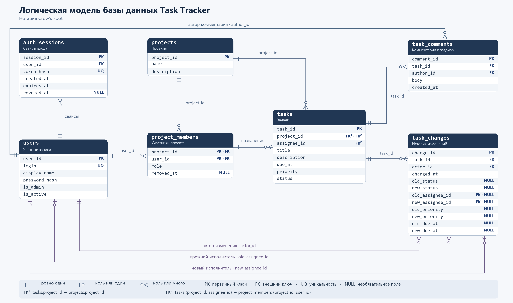

# Проектирование базы данных Task Tracker

Логическая модель охватывает учётные записи и сеансы, проекты и их участников, задачи, комментарии и историю изменений. Она подготовлена по разделам 3–6 и 8 документа «Описание предметной области» для согласования.

## Логическая ER-диаграмма



Каждая задача принадлежит одному проекту и имеет одного исполнителя. Связь между проектами и пользователями реализована через `project_members`. Пользователь получает одну роль в каждом проекте и может иметь разные роли в разных проектах. Для назначения задачи составной внешний ключ `(project_id, assignee_id)` ссылается на `project_members(project_id, user_id)`. Триггер дополнительно проверяет, что при назначении это активный участник с ролью исполнителя.

### Правила модели

- Администратор задаётся флагом `users.is_admin`, проектные роли задаются в `project_members.role`. Удаление участника из проекта означает заполнение `removed_at`. Перед снятием роли исполнителя у участника, которому назначены незавершённые задачи, их нужно переназначить. Завершённые задачи сохраняют исходную ссылку на участника. Деактивация учётной записи блокирует вход и новые назначения. Имеющиеся назначения руководитель может перераспределить.
- Коды статусов `todo`, `in_progress`, `in_review`, `done` соответствуют «К выполнению», «В работе», «На проверке» и «Завершена». Исполнитель выполняет первые два перехода для своей задачи. Руководитель подтверждает завершение или возвращает задачу в работу. При возврате из `in_review` триггер сохраняет указанную причину отдельным комментарием в той же транзакции.
- Предусмотрены три приоритета `low`, `medium`, `high`. Срок обязателен и хранится как `timestamptz`, поскольку момент просрочки должен быть однозначным. Даты в интерфейсе отображаются в выбранном часовом поясе.
- В комментарии хранятся идентификатор автора и время публикации. Имя берётся из `users.display_name`. При переименовании пользователя показывается его текущее имя.
- Одна запись `task_changes` описывает одно изменение задачи и может содержать несколько изменённых полей. Триггер записывает прежнее и новое значение, автора и время. Для неизменившихся полей обе колонки пары содержат `NULL`. Типы значений соответствуют типам полей задачи, а идентификаторы прежнего и нового исполнителя связаны с `users`.
- Признак просрочки вычисляет представление `task_overview` по условию `status <> 'done' AND due_at < statement_timestamp()`. Сводки строятся запросами по задачам.

## Обоснование третьей нормальной формы

**1НФ.** Все поля атомарны для операций системы. Участники проекта, сеансы, комментарии и события истории представлены отдельными строками. В истории каждая колонка имеет фиксированный смысл и тип. Например, `old_due_at` содержит одно прежнее значение срока.

**2НФ.** У `project_members` составной ключ `(project_id, user_id)`. Роль и отметка об удалении зависят от пары целиком. У остальных таблиц ключи одноатрибутные.

**3НФ.** Для принятых правил предметной области определители всех существенных функциональных зависимостей внутри каждой таблицы являются её кандидатными ключами. В таблице ниже стрелка обозначает функциональную зависимость.

| Таблица | Кандидатные ключи и функциональные зависимости |
| --- | --- |
| `users` | `user_id` и уникальный `login` по отдельности определяют всю строку, в том числе имя, хеш пароля и флаги учётной записи. |
| `auth_sessions` | `session_id` и уникальный `token_hash` по отдельности определяют пользователя и даты сеанса. Данные аккаунта получаются по внешнему ключу. |
| `projects` | `project_id → name, description`. Названия проектов могут совпадать. |
| `project_members` | `(project_id, user_id) → role, removed_at`. Имя пользователя и название проекта получаются по внешним ключам. |
| `tasks` | `task_id → project_id, assignee_id, title, description, due_at, priority, status`. Исполнитель может работать в нескольких проектах, поэтому `assignee_id` сам по себе не определяет `project_id`. Роль исполнителя определяется по участию в проекте. |
| `task_comments` | `comment_id → task_id, author_id, body, created_at`. Принадлежность к проекту определяется через задачу. |
| `task_changes` | `change_id` определяет задачу, автора, время, прежние и новые значения. `task_id` и время события могут повторяться. Текущие значения хранятся в задаче, значения на момент события входят в отдельный факт истории. |

Все семь таблиц приведены к 3НФ. Денормализация не применяется.

## Создание схемы и загрузка данных

Запускать в отдельной пустой базе PostgreSQL 17 с кодировкой UTF-8. Для регистронезависимого поиска по кириллице используйте локаль с поддержкой кириллицы, например ICU `ru`. Роль, выполняющая DDL, должна иметь право создать схему и установить расширение `pg_trgm` в `public`. Если расширение уже установлено, его классы операторов должны быть доступны в схеме `public`.

```powershell
$env:PGCLIENTENCODING = 'UTF8'
createdb -U postgres -T template0 -E UTF8 --locale-provider=icu --icu-locale=ru task_tracker_demo
psql -X -U postgres -d task_tracker_demo -v ON_ERROR_STOP=1 -f 01_schema.sql -f 02_seed.sql
```

`01_schema.sql` создаёт таблицы, ограничения `PRIMARY KEY`, `FOREIGN KEY`, `NOT NULL`, `UNIQUE`, `CHECK`, индексы, представление и триггеры. `02_seed.sql` заполняет пустую схему данными и проводит задачи через те же переходы, которые будет использовать приложение. В результате создаются 7 пользователей, 2 проекта, 8 записей об участии, 8 задач, 5 сеансов, 3 комментария и 12 событий истории. У тестовых пользователей общий демонстрационный пароль `TaskTrackerDemo2026!`. У каждого хеша своя соль.

Внешние ключи покрыты индексами. Например, составной ключ `project_members` покрывает выборку по `project_id`, а индекс `tasks_assignee_project_due_idx` покрывает поиск по равенству `assignee_id` и `project_id`. Индексы задач поддерживают выборки по проекту, сроку, статусу и приоритету. Частичный индекс незавершённых задач помогает при поиске просрочек, а GIN-индекс `pg_trgm` поддерживает поиск фрагмента названия через `ILIKE`. Индексы комментариев и истории позволяют выбирать записи задачи по времени. [Документация по ограничениям](https://www.postgresql.org/docs/17/ddl-constraints.html), [Документация по pg_trgm](https://www.postgresql.org/docs/17/pgtrgm.html).

### Контракт с FastAPI

Перед записью задачи или комментария API в текущей транзакции задаёт `set_config('task_tracker.actor_id', идентификатор_пользователя, true)`, передавая ID из проверенного сеанса. При возврате на доработку API задаёт `task_tracker.review_reason` перед обновлением одной задачи. Триггер сохраняет причину и очищает настройку. Для операций с назначениями и участниками предусмотрен стандартный уровень изоляции PostgreSQL `READ COMMITTED`.

FastAPI проверяет пароль, активность учётной записи, срок и отзыв сеанса, права администратора и доступ к чтению данных проекта. При выходе API отзывает сеанс через `revoked_at`. Клиент обращается к данным через API. Запись в историю и изменение проекта, участников и учётных записей доступны только доверенной серверной части.

## Примеры проверочных запросов

Результаты для свежей загрузки приведены под запросами. Относительные сроки фиксируются при загрузке.

```sql
-- Сводка по статусам, включая статусы без задач
SELECT s.status, count(t.task_id) AS task_count
FROM unnest(enum_range(NULL::task_tracker.task_status)) AS s(status)
LEFT JOIN task_tracker.tasks AS t ON t.status = s.status
    AND t.project_id = (SELECT project_id FROM task_tracker.projects WHERE name = 'Личный кабинет')
GROUP BY s.status
ORDER BY s.status;

-- Просроченные задачи проекта
SELECT t.title, t.status, t.due_at
FROM task_tracker.task_overview AS t
JOIN task_tracker.projects AS p USING (project_id)
WHERE p.name = 'Личный кабинет' AND t.is_overdue
ORDER BY t.due_at;

-- Незавершённые задачи по исполнителям проекта
SELECT u.display_name, count(*) AS open_tasks
FROM task_tracker.tasks AS t
JOIN task_tracker.projects AS p USING (project_id)
JOIN task_tracker.users AS u ON u.user_id = t.assignee_id
WHERE p.name = 'Личный кабинет' AND t.status <> 'done'
GROUP BY u.user_id, u.display_name
ORDER BY open_tasks DESC, u.display_name;

-- Мои задачи с фильтрами по названию, проекту, статусу, приоритету и сроку
SELECT p.name AS project, t.title, t.status, t.priority, t.due_at
FROM task_tracker.tasks AS t
JOIN task_tracker.projects AS p USING (project_id)
JOIN task_tracker.users AS u ON u.user_id = t.assignee_id
WHERE u.login = 'anna' AND t.title ILIKE '%API%'
    AND p.name = 'Личный кабинет' AND t.status = 'in_review'
    AND t.priority = 'high' AND t.due_at < statement_timestamp()
ORDER BY t.due_at;

-- История задачи с авторами изменений
SELECT u.display_name, c.*
FROM task_tracker.task_changes AS c
JOIN task_tracker.tasks AS t USING (task_id)
JOIN task_tracker.users AS u ON u.user_id = c.actor_id
WHERE t.title = 'Реализовать API входа'
ORDER BY c.changed_at, c.change_id;
```

| Сценарий | Ожидаемый результат |
| --- | --- |
| Сводка по статусам | `todo` - 2, `in_progress` - 1, `in_review` - 2, `done` - 1. |
| Просроченные задачи проекта | «Согласовать макет», «Подготовить стенд», «Реализовать API входа». Завершённая задача «Подготовить документацию» имеет истёкший срок и исключается из выборки. |
| Загрузка исполнителей | У Анны Орловой 3 незавершённые задачи, у Ивана Егорова 2. |
| «Мои задачи» с фильтрами | Одна строка с задачей «Реализовать API входа». |
| История задачи | 5 событий. Первое содержит смену исполнителя с Ивана на Анну, повышение приоритета и перенос срока. Также есть возврат с проверки и повторная отправка. Причина возврата доступна в комментариях. |
